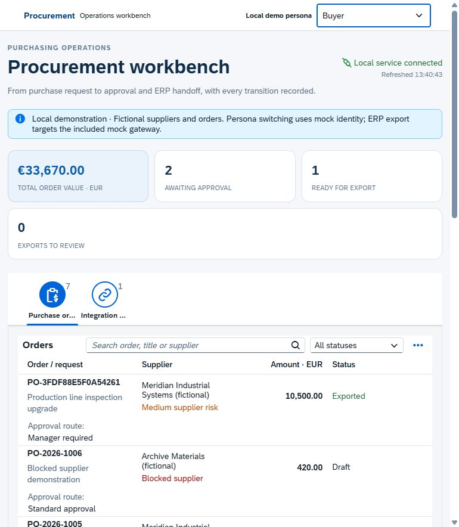
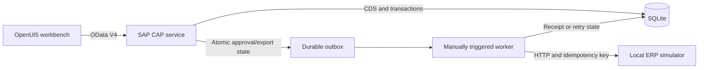

# SAP Procurement Approval Workbench

A purchasing workflow built with **SAP Cloud Application Programming Model
(CAP), CDS, OData V4 and OpenUI5**. It connects purchase-order validation and
approval to a durable integration outbox, with explicit roles, revision checks
and an application audit trail.

An independent learning and portfolio project by **Mahou Mehdi**. The SAP CAP
runtime and UI5 interface are real; the connected ERP is a clearly labeled local
simulator. No customer deployment, SAP certification, BTP deployment or live
S/4HANA integration is claimed.



The [integration receipt screenshot](docs/screenshots/integration-receipt.jpg)
shows an order created through the interface, approved by a manager and accepted
by the local ERP simulator.

## Business scenario

A buyer prepares an order with 1–100 line items. The server calculates its EUR
value and checks the supplier. Submitted orders need a separate approver; orders
of at least **EUR 10,000** or involving a **high-risk supplier** need a manager.
Approved orders enter an integration queue. The integrator manually processes
one due job at a time. A network failure leaves a durable job whose next attempt
reuses the original payload and external request key.

This is a focused purchasing extension. It does not implement inventory, goods
receipts, invoice verification, accounting or payment.

## Run locally

Requires **Node.js 22.15 or later** and npm. The first installation/build downloads
dependencies and official OpenUI5 resources. Afterward, both applications run on
localhost without a SAP account, cloud subscription or API key.

```sh
git clone https://github.com/Mahou-Mehdi/sap-procurement-workbench.git
cd sap-procurement-workbench
npm ci
npm run build
npm run db:init
```

In one terminal, start the fictional ERP:

```sh
npm run start:erp
```

In a second terminal, start the workbench:

```sh
npm start
```

Open **http://127.0.0.1:4004/workbench/**. The simulator listens on port 4010.
Stop each process with Ctrl+C. Initialization refuses to overwrite an existing
database. Saved orders and simulator receipts live in the ignored `runtime/`
directory; neither is committed to Git.

The visible persona selector is for local demonstrations. Its named users use
the public password `demo`. It does not represent enterprise SSO. The server binds
to localhost and deliberately refuses a production environment with this setup.

| Persona | Capability |
| --- | --- |
| `buyer` | Create, edit and submit owned drafts |
| `approver` | Approve ordinary submitted orders; reject any submitted order with a reason |
| `manager` | Approve threshold/high-risk orders; reject submitted orders with a reason |
| `integrator` | Queue exports, process jobs and retry failed exports |
| `auditor` | Read orders, integration state and audit history |

All five personas can read orders and their history. Requesters cannot approve
their own orders, even when they also hold an approval role. The server enforces
these rules independently of the UI's contextual buttons.

## A five-minute demonstration

1. As **buyer**, create a two-line order below EUR 10,000 for Northfield Components
   (the fictional low-risk supplier) and submit it.
2. As **approver**, review the amount, line items and supplier; approve it.
3. As **integrator**, queue the export, then process the integration queue.
4. Inspect the external reference, job attempts and audit history as **auditor**.
5. Try a high-risk supplier or a total of EUR 10,000 and demonstrate the manager rule.

For failure recovery, start the simulator with `ERP_FAIL_FIRST=1` and use a new
order. The first send returns a deliberate transient error. Wait until its
displayed retry time, click **Process next** again, and inspect the final receipt.
There is no background polling worker. **Retry failed** is a separate action for
an order that has reached `EXPORT_FAILED`.

PowerShell example:

```powershell
$env:ERP_FAIL_FIRST = '1'
npm run start:erp
```

## Design



- **CDS model:** suppliers, orders, composed line items, audit events and export jobs.
- **Server actions:** controlled state transitions; direct API writes to workflow
  entities are rejected.
- **Amounts:** positive quantities support up to three decimal places and positive
  EUR unit prices support two. Each line is rounded half-up to cents using integer
  arithmetic before summation. The total must be between EUR 0.01 and
  EUR 999,999,999,999.99; the client cannot choose the persisted total.
- **Concurrency:** expected revisions and conditional updates reject stale changes.
  State changes and their audit entries share a database transaction.
- **Integration:** an immutable payload is queued with the business transition;
  the HTTP call happens outside that transaction. Retry attempts reuse the same
  payload and idempotency key.
- **Recovery:** at most three send attempts per retry cycle, automatic retry-delay
  calculation, a 30-second processing lease and explicit failed states. Each send
  still requires **Process next**. Explicitly retrying a failed order resets the
  attempt counter while preserving its original payload and key.
- **Interface:** actual OpenUI5 controls, responsive worklist, item editor, approval
  actions, history and integration queue. This is custom UI5, not Fiori elements.

The simulator's idempotency behavior is part of this project's custom API
contract. It must not be assumed to be supported by an arbitrary SAP API.
See [architecture and transaction boundaries](docs/architecture.md) for the
state transitions, retry timing and crash-recovery behavior.

## Test and inspect

```sh
npm test
```

The **31 automated tests** exercise business rules, role enforcement, direct-write rejection,
stale/concurrent actions, transactional audit behavior, payload validation,
retry/replay behavior and duplicate prevention. GitHub Actions builds the UI and
runs the tests on Node.js 22 and 24.

The OData service is at `/odata/v4/procurement/`; its contract is available at
`/odata/v4/procurement/$metadata`. Use Basic authentication for the named demo
users when calling the API outside the interface. This edition accepts individual
OData operations and rejects `$batch` with HTTP 501, preserving the worker's
separate transaction boundaries.

| Directory | Purpose |
| --- | --- |
| `db/` | CDS domain model and fictional seed records |
| `srv/` | Service contract, validation and business workflow |
| `lib/` | Integration mapping, HTTP client and durable worker |
| `mock/` | Separate persistent ERP simulator |
| `app/workbench/webapp/` | OpenUI5 application source |
| `test/` | Automated tests and isolated fixtures |
| `docs/` | Architecture, learning exercises and SAP scope boundaries |

## Build experience with it

Follow the [learning lab](docs/learning-lab.md): trace the OData requests, change a
rule with boundary tests, reproduce a conflict, recover a failed export and add a
cost center across the model, UI and integration payload. Keep your own notes on
design decisions and failures you resolve.

The [SAP boundaries guide](docs/sap-boundaries.md) separates implemented CAP/UI5
skills from future BTP, SAP HANA, identity and live S/4HANA work. This project
demonstrates development and integration patterns; ABAP and SAP Integration Suite
would require separate practical work.

Official references: [CAP](https://cap.cloud.sap/docs/),
[service consumption](https://cap.cloud.sap/docs/guides/services/consuming-services),
[CAP authentication](https://cap.cloud.sap/docs/node.js/authentication),
[OpenUI5](https://sdk.openui5.org/),
[SAP CAP learning course](https://learning.sap.com/courses/introduction-to-sap-cloud-application-programming-model).

## License

Original application code and fictional examples: [MIT](LICENSE). SAP CAP,
OpenUI5 and other dependencies retain their respective licenses and trademarks.
This is an independent portfolio project and is not an official SAP product.
